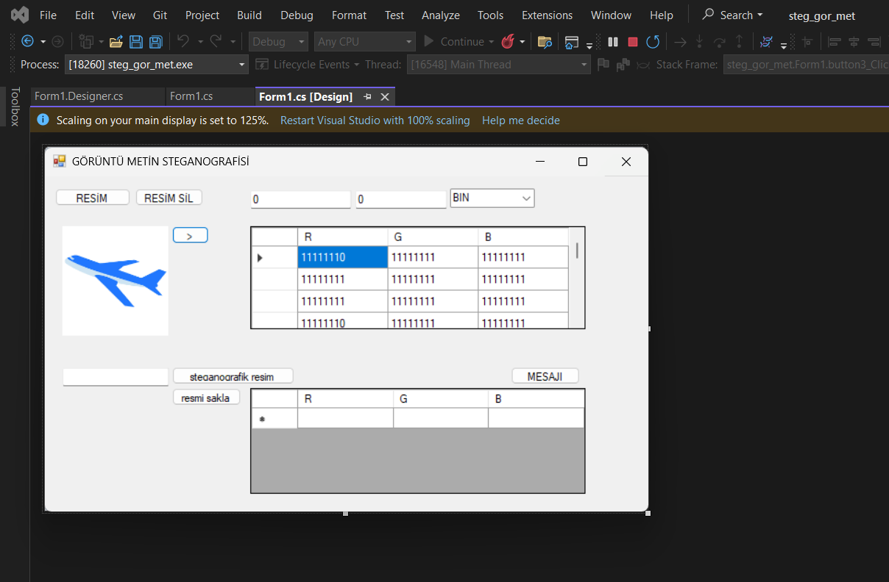
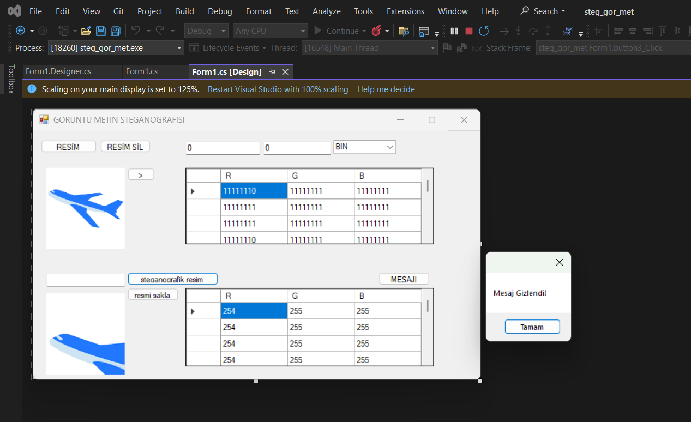
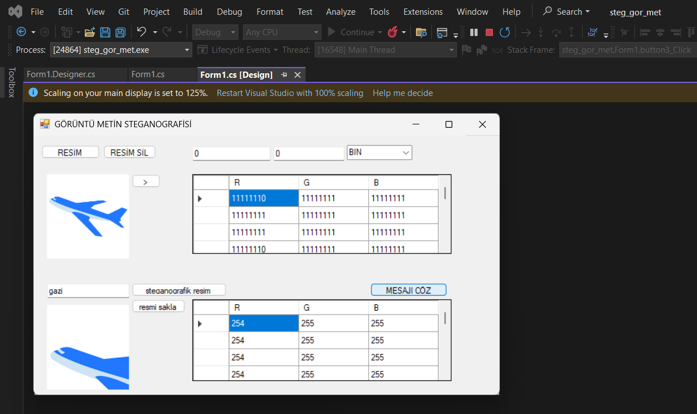

\# Görüntü Metin Steganografisi


C# ve Windows Forms ile geliştirilmiş bu masaüstü uygulaması, metni bir görüntünün kırmızı (R) renk kanalının en düşük anlamlı bitinde (LSB) saklar ve aynı yöntemle geri çıkarır. Uygulama ayrıca görüntüdeki 8 × 8 piksellik bir alanın RGB değerlerini ikili (BIN), onluk (DEC) veya onaltılık (HEX) biçimde inceleyebilir.


\## Özellikler


\- PNG, JPG ve BMP görüntülerini yükleme

\- Seçilen görüntüyü arayüzde görüntüleme

\- X ve Y başlangıç koordinatlarından itibaren 8 × 8 pikselin R, G, B değerlerini BIN, DEC veya HEX olarak listeleme

\- ASCII metnini kırmızı kanalın en düşük bitlerine sırayla yazarak görüntüye gizleme

\- Sonuç görüntüsünü PNG olarak kaydetme

\- Yüklenen görüntüdeki mesajı çözerek metin alanında gösterme

\- Görüntü ve tabloları temizleme


\## Nasıl çalışır?


Gizleme sırasında metin ASCII baytlarına çevrilir ve sonuna mesajın bittiğini belirtmek için `\\0` (sıfır) baytı eklenir. Her baytın bitleri en anlamlı bitten başlayarak görüntü piksellerine sırayla yazılır. Her bit, pikselin kırmızı kanal değerinin tek/çift olmasına karşılık gelir: bit `1` ise R tek, bit `0` ise R çift yapılır. Yeşil ve mavi kanallar değiştirilmez.


Çözme işlemi pikselleri aynı sırayla tarar, her R değerinin tek/çift olmasından bitleri toplar ve sıfır baytına ulaşınca durur.


\## Kullanım


\### Mesaj gizleme


1\. \*\*RESİM YÜKLE..\*\* düğmesiyle bir kaynak görüntü seçin.

2\. Alt bölümdeki metin alanına gizlemek istediğiniz ASCII metnini yazın.

3\. \*\*steganografik resim oluştur\*\* düğmesine basın. Sonuç alt görüntü alanında görünür.

4\. \*\*resmi sakla\*\* düğmesiyle çıktıyı PNG olarak kaydedin.


\### Mesajı çözme


1\. Mesaj gömülmüş PNG dosyasını \*\*RESİM YÜKLE..\*\* düğmesiyle yükleyin.

2\. \*\*MESAJI ÇÖZ\*\* düğmesine basın. Bulunan metin metin alanında gösterilir.


\### Piksel değerlerini inceleme


1\. Bir görüntü yükleyin.

2\. X ve Y kutularına 8 × 8 alanın başlangıç koordinatlarını girin.

3\. BIN, DEC veya HEX biçimini seçin.

4\. \*\*>\*\* düğmesine basın. RGB değerleri üst tabloda gösterilir. Gizleme işlemi sonrasında alt tablo, sonuç görüntüsünün aynı koordinatlardaki RGB değerlerini gösterir.


\## Teknolojiler ve gereksinimler


\- C#

\- Windows Forms

\- .NET Framework 4.7.2

\- Microsoft Visual Studio


Çözümü (`steg\_gor\_met.sln`) Visual Studio'da açıp `steg\_gor\_met` projesini başlangıç projesi olarak çalıştırın.


\## Sınırlamalar


\- Metin `Encoding.ASCII` ile kodlanır. Türkçe karakterler ve ASCII dışındaki karakterler güvenilir biçimde korunmaz; ASCII karakterlerle deneyin.

\- Görüntü başına kapasite yaklaşık `genişlik × yükseklik` bittir; bunun bir kısmı bitiş işareti olan sıfır baytına ayrılır. Kod kapasiteyi aşan metni ayrıca bildirmiyor; kısa mesajlar kullanın.

\- Çözme, görüntüyü soldan sağa ve yukarıdan aşağıya tarar. Mesajın okunması için gizleme sırasında kullanılan PNG çıktısını yükleyin; JPEG gibi kayıplı biçimlere yeniden dönüştürmeyin.

\- Piksel inceleme için X ve Y değerleri geçerli olmalı ve görüntüde 8 × 8 alan sığmalıdır. Arayüz girdileri için sınır doğrulaması bulunmadığından geçersiz koordinatlar hata oluşturabilir.

\- Bu yöntem eğitim ve gösterim amaçlı basit steganografidir; şifreleme sağlamaz ve mesajın gizliliğini kriptografik olarak korumaz.


\## Ekran görüntüleri


README'ye uygulamanın kullanımını gösteren ekran görüntüleri eklemek faydalıdır. Özellikle şu akıştan görüntü seçin:


1\. Yüklenmiş kaynak görüntü ve RGB tablosu

2\. Mesaj gizlendikten sonraki sonuç ve başarı bildirimi

3\. Kaydedilmiş/gizli görüntü yüklendikten ve mesaj çözüldükten sonraki durum


Görüntüleri proje içinde `docs/screenshots/` klasörüne koyun ve gerçek dosya adlarına göre bağlantıları güncelleyin:


```md

!\[Kaynak görüntü ve RGB değerleri](docs/screenshots/kaynak-ve-rgb.png)

!\[Mesaj gizleme sonucu](docs/screenshots/mesaj-gizleme.png)

!\[Mesaj çözme sonucu](docs/screenshots/mesaj-cozme.png)

```


Paylaşmadan önce ekran görüntülerinde görünen kişisel klasör adlarını ve ilgisiz pencereleri kırpın. Dosya seçme penceresi ekran görüntüsü temel özellikleri anlatmadığından README için gerekli değildir.


\## Lisans


Bu projeye henüz bir lisans eklenmemiştir.


## Proje ekran görüntüleri

### Kaynak görüntü ve RGB değerleri


### Mesaj gizleme


### Mesaj çözme
